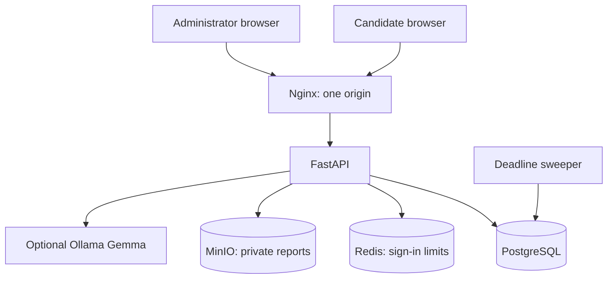
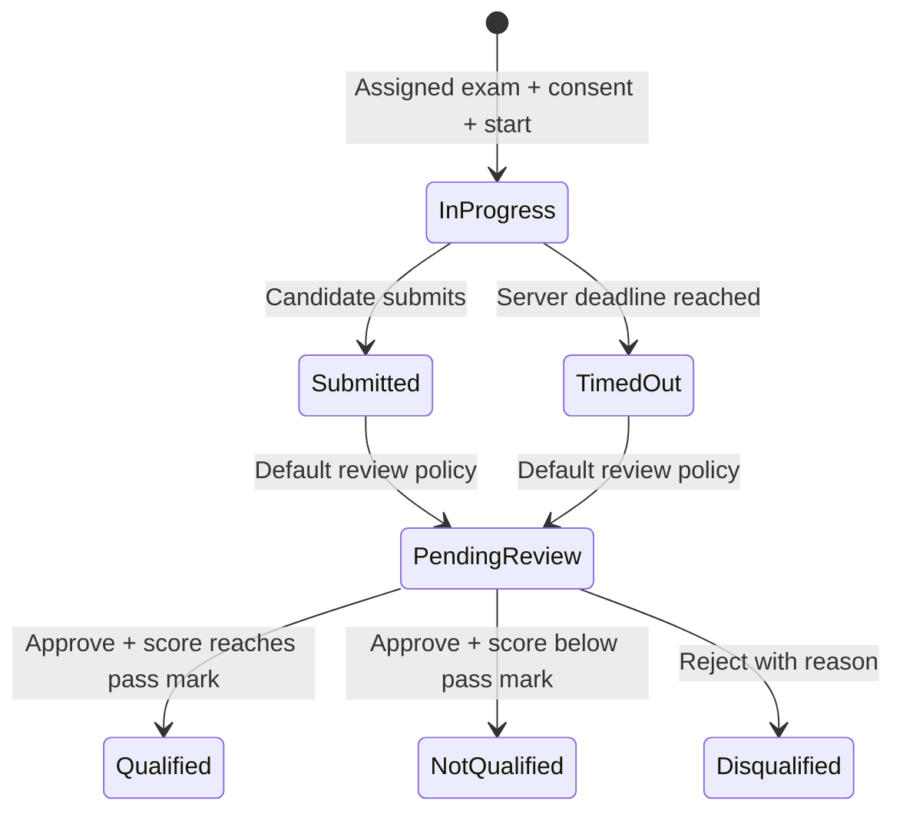

# Architecture and API map

## Responsibilities

- Frontend renders the UI, asks for fullscreen, saves answers, queues best-effort browser signals and retries pending writes. It is not a trusted security boundary.
- API verifies cookie signature, expiry, current session ID, roles, enrollment, attempt ownership, client binding and deadline. It never accepts a client score or correct answer key.
- PostgreSQL is authoritative for all exam state. Row locks serialize attempt mutations; account locks serialize logins/starts/recovery. Unique constraints enforce user IDs, one enrollment and one attempt per user/exam, and event IDs per attempt.
- Every relevant request checks expiry before reading/writing an attempt. The sweeper runs every 10 seconds, marking heartbeat gaps and finalizing overdue attempts; if it is briefly unavailable, request-time checks still reject late writes. Scoring includes only stored answers, regardless of the displayed timer.
- Redis atomically increments a 5-minute rate-limit counter per account and source IP. Limit: 10 sign-in requests per account and 40 per IP per window. Limiter failure closes sign-in with 503. These are requests, including successful sign-ins; tune for your venue's shared-IP traffic before use.
- Nginx overwrites forwarding headers; the API trusts forwarding headers only because the supplied Compose keeps the API internal. Do not expose this API directly with unrestricted forwarded-header trust.
- MinIO stores immutable-by-application CSV snapshot objects. Authorized admin downloads are streamed through the API; object paths are never accepted directly from the browser. The app uses root MinIO credentials only in this local reference setup. Use a dedicated bucket-scoped service account in deployment.
- Gemma is a question-draft assistant. It receives only the administrator's topic. It cannot approve questions, grade answers, determine eligibility or detect cheating. The browser editor and publish step require human verification.

## Attempt state

Storage keeps completion status (`in_progress`, `submitted`, `timed_out`) separate from result outcome (`in_progress`, `pending_review`, `qualified`, `not_qualified`, `disqualified`). A reviewer can revise a decision; each revision is audited. A review flag remains in history after a decision. If mandatory review is disabled, an unflagged closed attempt immediately receives its calculated pass/fail outcome.

Recovery is permitted only while in progress. It revokes the login and releases the tab binding. It preserves the attempt, answer state, question order and original deadline. Unsynced answers remain only in the originating tab's storage and cannot be recovered from a lost device.

## Core endpoints

All routes use `/v1`. Cookie-based sessions apply to Swagger and Postman too. Requests that inspect/mutate a candidate attempt require `X-Exam-Client`, matching the UUID used in `start`.

| Method | Path | Access / purpose |
|---|---|---|
| POST | `/auth/login` | User ID/password; returns role and sets HttpOnly cookie |
| GET | `/auth/me` | Current authenticated user |
| POST | `/auth/logout` | Revoke session |
| GET | `/exams` | Assigned published exams for candidate; all exams for admin |
| POST | `/exams/{id}/start` | Candidate; `client_id` UUID and `consent: true` |
| GET | `/attempts/{id}` | Owner + client binding; no answer keys |
| PUT | `/attempts/{id}/answer` | Owner + client binding; `question_id`, `selected_index` (0–3 or null) |
| POST | `/attempts/{id}/heartbeat` | Owner + client binding; update liveness |
| POST | `/attempts/{id}/events` | Owner + client binding; event UUID and allowed kind |
| POST | `/attempts/{id}/submit` | Owner + client binding; idempotent finalization |
| GET, POST | `/admin/candidates` | List/create candidate accounts |
| POST | `/admin/candidates/{id}/password` | Reset candidate password; revoke session |
| POST | `/admin/exams` | Create draft with validated question array |
| GET, PUT | `/admin/exams/{id}` | Read full admin exam; edit draft only |
| POST | `/admin/exams/{id}/publish` | Human confirmation body `{"reviewed":true}`; immutable thereafter |
| POST | `/admin/exams/{id}/assign` | Assign `user_id` |
| GET | `/admin/attempts` | Monitoring/review overview |
| GET | `/admin/attempts/{id}/events` | Received browser event timeline |
| POST | `/admin/attempts/{id}/recover` | Recover a session with a required `note` |
| POST | `/admin/attempts/{id}/review` | `decision: approve/reject`, `note` required |
| POST | `/admin/reports` | Generate/store CSV, return authorized download URL |
| GET | `/admin/reports/{id}` | Download report owned by that admin |
| GET | `/admin/audit` | Latest 200 audit records |
| POST | `/admin/questions/draft` | Optional Gemma topic/count request |
| GET | `/health` | DB/Redis readiness; does not assert MinIO/Ollama readiness |

## Data and scaling boundaries

Answers and question order use JSON columns; each answer request replaces a JSON map under the attempt row lock. This keeps the small reference implementation straightforward. For large examination programs, benchmark this design and consider a normalized answer table and paginated admin queries. The dashboards currently load all candidate/exam/attempt records; they are suited to evaluation and small deployments, not unmeasured large-scale traffic.

The shipped service starts one API worker and one lightweight sweeper. PostgreSQL `FOR UPDATE SKIP LOCKED` supports separate sweepers without duplicate finalization, but real PostgreSQL concurrency tests are still required. SQLite tests do not verify row locking. No Temporal service or payload-size changes are needed.
